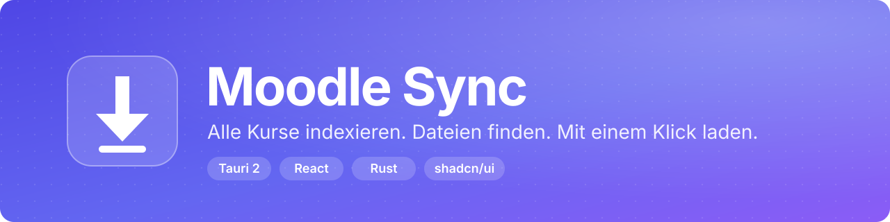

<p align="center">
  
</p>

<p align="center">
  <b>Desktop-App, die alle deine Moodle-Kurse indexiert und Unterlagen gezielt in einen Ordner lädt.</b><br>
  Schnell, lokal, ohne Konto bei Dritten.
</p>

<p align="center">
  
  
  
  
  
</p>

---

## Wofür ist das gut?

Moodle ist zum Stöbern gebaut, nicht zum Mitnehmen. Wer sich vor der Klausur alle Folien, Skripte und
Übungsblätter eines Semesters holen will, klickt sich durch Dutzende Seiten, Abschnitte und Ordner.

**Moodle Sync** nimmt dir das ab:

- Du meldest dich einmal an. Die App liest alle deine Kurse mit Abschnitten, Dateien und Links ein.
- Du suchst, filterst und wählst aus: eine Datei, eine Woche, einen Kurs oder mehrere Kurse zugleich.
- Ein Klick lädt alles in eine saubere Ordnerstruktur (`Kurs / 01 Woche / Datei.pdf`).
- Beim nächsten Mal siehst du sofort, **was neu oder geändert ist**, und lädst nur das nach.

Typische Einsatzfälle:

| Situation | Was Moodle Sync macht |
| --- | --- |
| Semesterstart | Alle Kurse auf einmal in eine Ordnerstruktur ziehen |
| Prüfungsphase | Nach „Graphen" suchen, über alle Kurse, und nur diese Dateien laden |
| Wöchentlich | „12 Neues laden" pro Kurs statt alles neu durchzuklicken |
| Lernen mit KI | Ordner pro Abschnitt als Quelle für z. B. NotebookLM oder Anki-Karten |
| Offline-Zugriff | Unterlagen lokal, auch ohne VPN oder Hochschulnetz |

## Funktionen

**Indexieren**
- Mehrere Moodle-Konten, Wechsel über die Sidebar. Das Favicon der Hochschule wird automatisch geholt.
- Kurse, Abschnitte, Dateien, Ordner und Links (Moodle-Aktivität „URL").
- Lokaler Cache, Auto-Aktualisierung beim Start (älter als 6 Stunden) und manuell per Button.

**Finden**
- `⌘K`-Palette springt zu Kursen, Dateien und Aktionen.
- Filter nach Dateityp (PDF, Folien, Tabellen, Archive, Code, Links …) und nach „Nur Neues".
- Sortierung nach Kursreihenfolge, Name, Datum oder Größe.
- Favoriten und ausblendbare Kurse.
- Vorschau per Quick Look (macOS) ohne vorher alles zu laden.

**Laden**
- Auswahl per Klick, Shift-Klick für Bereiche, `⌘A` für alles Sichtbare.
- Gemerkter Zielordner **pro Kurs**, Ordner pro Kurs und Abschnitt optional.
- **Neu / Geändert-Erkennung:** die App merkt sich, was du schon hast. Geänderte Dateien werden ersetzt.
- 4 parallele Downloads, Fortschritt pro Datei, Abbrechen, Wiederholung bei Netzfehlern, „erneut versuchen" für Fehlgeschlagene.
- Dock-Fortschritt und Benachrichtigung am Ende.
- Links werden als `.webloc` (macOS) bzw. `.url` gespeichert.

## Installation

### Fertige App
Unter [Releases](../../releases) gibt es Bundles für macOS, Windows und Linux.

> Die Builds sind **nicht signiert**. Auf macOS: Rechtsklick auf die App, **Öffnen**. Oder einmalig
> `xattr -dr com.apple.quarantine "/Applications/Moodle Sync.app"`.

### Selbst bauen
Voraussetzungen: [Node](https://nodejs.org) 22+, [pnpm](https://pnpm.io), [Rust](https://rustup.rs) und die
[Tauri-Systemabhängigkeiten](https://tauri.app/start/prerequisites/).

```bash
pnpm install
pnpm tauri:dev     # Desktop-App im Entwicklungsmodus
pnpm tauri:build   # fertiges Bundle (.app/.dmg, .msi, .deb/.AppImage)
pnpm dev           # nur das Frontend im Browser, mit Demo-Daten
```

## Erste Schritte

1. App starten, **Moodle-Adresse** eingeben (z. B. `moodle.meine-hochschule.de`), Benutzername und Passwort.
2. Warten, bis der Index fertig ist, das dauert je nach Kursanzahl wenige Sekunden.
3. Kurs öffnen, Dateien auswählen, **Herunterladen**, Zielordner wählen. Fertig.

## Kompatibilität

Der Login läuft über Moodles **Mobile-Webservice** (`/login/token.php`), also dieselbe Schnittstelle wie die
offizielle Moodle-App.

| Fall | Funktioniert? |
| --- | --- |
| Normaler Moodle-Login (Benutzername und Passwort) | Ja |
| Hochschul-SSO / Shibboleth / SAML | Meist **nein**, da kein Passwort-Login möglich ist |
| Mobile-Webservice vom Admin deaktiviert | Nein |
| Dateien in Kursen, Ordnern, Links | Ja |
| Aufgaben-Abgaben, Forum-Anhänge, Videos aus Streaming-Plugins | Nicht enthalten |

Wenn die offizielle Moodle-App bei deiner Hochschule funktioniert, ist die Chance gut, dass Moodle Sync es auch tut.

## Datenschutz und Sicherheit

- **Kein Server dazwischen.** Die App spricht ausschließlich mit deiner Moodle-Instanz. Keine Telemetrie, kein Tracking.
- Dein **Passwort wird nicht gespeichert**, nur ein Zugriffstoken. Es liegt in `accounts.json` im App-Datenordner
  (macOS: `~/Library/Application Support/de.primecodes.moodlesync/`, Rechte `600`). Konto entfernen löscht es.
- Der Token wird **nur an den eigenen Moodle-Host** geschickt, auch bei Weiterleitungen nicht an fremde Server.
- Zielpfade vom Server werden bereinigt (kein `..`, keine Sonderzeichen), Dateien landen immer im gewählten Ordner.
- Index und Download-Verlauf liegen lokal im selben Datenordner.

## Tastenkürzel

| Taste | Aktion |
| --- | --- |
| `⌘K` / `Ctrl K` | Suche und Aktionen |
| `/` | Dateifilter fokussieren |
| `⌘A` | Alle sichtbaren Dateien auswählen |
| `Shift` + Klick | Bereich auswählen |
| `Esc` | Auswahl leeren, Filter löschen, zurück |

## Technik

| Schicht | Stack |
| --- | --- |
| App-Hülle | [Tauri 2](https://tauri.app), Rust |
| Netzwerk / Downloads | `reqwest` (rustls), `tokio`, Streaming mit `.part`-Dateien |
| Oberfläche | React 19, Vite, Tailwind CSS 4 |
| Komponenten | [shadcn/ui](https://ui.shadcn.com) (base-ui), `cmdk`, `lucide-react` |
| Liste | `@tanstack/react-virtual` für große Kurse |

```
src/            React-Oberfläche (Komponenten, Hilfsfunktionen, Demo-Daten)
src-tauri/      Rust-Backend (Moodle-API, Downloads, Verlauf, Favicon)
docs/           Banner
.github/        Release-Workflow (Bundles für alle Plattformen bei v*-Tag)
```

Tests: `cargo test --manifest-path src-tauri/Cargo.toml` (Pfad-Bereinigung, URL-Normalisierung, Index-Parsing).

## Roadmap

- [ ] Export für NotebookLM: PDFs pro Abschnitt zusammenführen, sprechende Namen
- [ ] Token im System-Schlüsselbund statt in einer Datei
- [ ] Auto-Update (Tauri-Updater mit Signatur)
- [ ] Signierte macOS- und Windows-Builds

## Hinweis zur Nutzung

Moodle Sync ist für den **eigenen Zugriff auf deine eigenen Kurse** gedacht, so wie du sie auch im Browser öffnen
könntest. Beachte die Nutzungsbedingungen deiner Hochschule und das Urheberrecht an den Unterlagen: Nicht
weitergeben, was nicht für die Weitergabe gedacht ist. Das Projekt steht in keiner Verbindung zu Moodle Pty Ltd.
